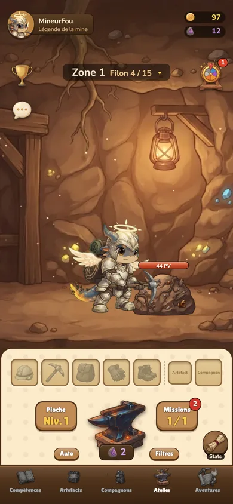
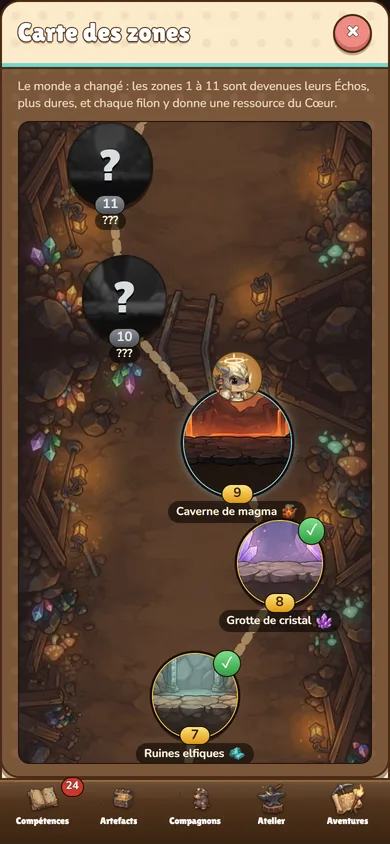
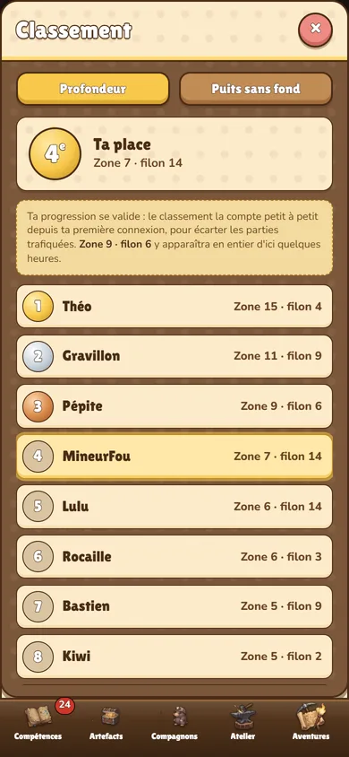
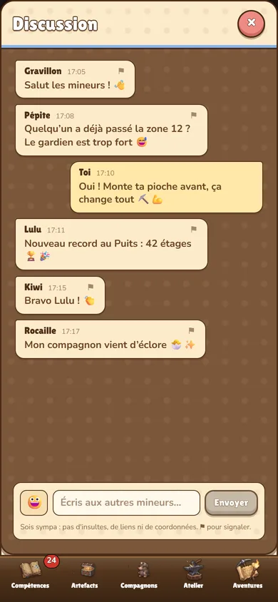
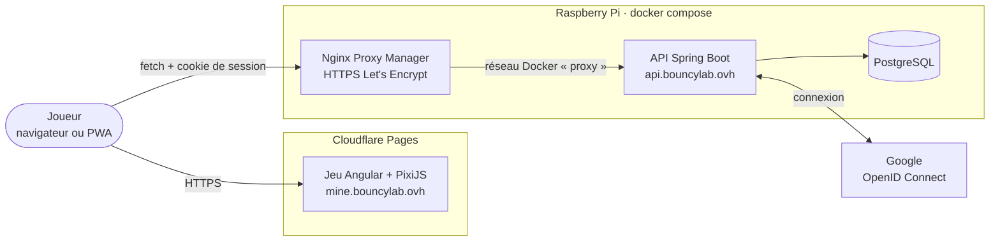

# Mine Explorer

[](https://github.com/theodanel/mine-explorer/actions/workflows/ci.yml)
[](https://github.com/theodanel/mine-explorer/actions/workflows/codeql.yml)

**RPG idle de minage, pensé pour le téléphone et jouable dans le navigateur.** Ton petit mineur creuse tout seul : tu forges son équipement, améliores sa pioche, le fais évoluer de l'Apprenti à la Légende du Cœur du monde, et descends de zone en zone jusqu'au cœur de la mine. Compagnons, artefacts, Puits sans fond, Forge du Cœur, classement et discussion entre joueurs.

🎮 **Jouer** : https://mine.bouncylab.ovh

<p align="center">
  
  
  
  
</p>

## Sommaire

- [Fonctionnalités](#fonctionnalités)
- [Architecture](#architecture)
- [Stack technique](#stack-technique)
- [Démarrer en local](#démarrer-en-local)
- [Tests et qualité](#tests-et-qualité)
- [Déploiement](#déploiement)
- [Sécurité](#sécurité)
- [Structure du dépôt](#structure-du-dépôt)
- [Documentation](#documentation)
- [Contribuer](#contribuer)

## Fonctionnalités

| Jeu | En ligne |
|---|---|
| Minage automatique, 20 zones, gardiens chronométrés, Échos des anciennes zones | Connexion Google (aucun mot de passe, ni e-mail ni nom transmis) |
| Forge aléatoire d'équipement en 10 matériaux, pioche à améliorer, Atelier | Sauvegarde cloud entre appareils, sans jamais écraser une partie sans l'accord du joueur |
| Évolution du mineur et Légende du Cœur du monde à 5 étoiles | Classements profondeur et Puits sans fond, protégés par un anti-triche de plausibilité |
| Compétences et sorts, artefacts et reliques, compagnons et Défi | Discussion entre joueurs : texte libre et emojis, filtre, signalement, modération |
| Aventures : Puits sans fond, Chasse au filon, Forge express, Expédition aux flambeaux, Marchand nain | Pages légales : confidentialité, conditions d'utilisation |
| Prise en main progressive, gains hors ligne, PWA installable | |

Le jeu tourne entièrement dans le navigateur, même sans compte : la partie est gardée dans le `localStorage`. Le serveur ne fait que la conserver, la vérifier et la classer.

## Architecture



- **Le jeu** (`frontend/`) : une application Angular sans zone.js, avec une scène PixiJS pour la mine. Toute la logique de jeu est dans des fichiers de règles purs et testés (`*-rules.ts`), séparés de l'affichage.
- **Le serveur** (`backend/`) : une API REST Spring Boot. Sessions en base, cookie `HttpOnly`, CSRF, CORS limité au jeu. Aucune route ne prend d'identifiant de joueur : il vient toujours de la session.
- **L'hébergement** : le jeu est un site statique sur Cloudflare Pages, publié par la CI. Le serveur et sa base tournent sur un Raspberry Pi 5, derrière Nginx Proxy Manager.

Détails : [docs/technique/architecture.md](docs/technique/architecture.md) et [docs/technique/backend.md](docs/technique/backend.md).

## Stack technique

| | Technologies |
|---|---|
| Jeu | Angular 21 (signaux, sans zone.js, composants autonomes), PixiJS 8, TypeScript strict, SCSS, Web Worker pour l'audio |
| Serveur | Java 21, Spring Boot 4.1, Spring Security (OAuth2/OIDC), Spring Session JDBC, Spring Data JPA, Flyway |
| Données | PostgreSQL 17 en production, H2 en développement et en test |
| Tests | Vitest (jeu), JUnit 5 + MockMvc (serveur), simulateur d'économie en TypeScript |
| CI/CD | GitHub Actions, CodeQL, Dependabot, déploiement Cloudflare Pages avec `wrangler` |
| Hébergement | Cloudflare Pages, Raspberry Pi 5 (Docker, ARM 32 bits), Nginx Proxy Manager |

## Démarrer en local

Prérequis : **Node.js 24**, **JDK 21**, Git. Le wrapper Maven est inclus.

```bash
# Le jeu, sur http://localhost:4200
cd frontend
npm ci
npm start
```

Le jeu fonctionne seul. Pour le jeu en ligne (connexion, sauvegarde cloud, classement, discussion), lance aussi le serveur en profil `dev`, avec une base H2 locale :

```bash
# Le serveur, sur http://localhost:8080
cd backend
./mvnw spring-boot:run -Dspring-boot.run.profiles=dev
```

Sous Windows : `.\mvnw.cmd spring-boot:run "-Dspring-boot.run.profiles=dev"`. Pour tester la connexion Google en local, voir [docs/technique/backend.md](docs/technique/backend.md#lancer-en-local).

Autre possibilité, le jeu seul dans Docker : `docker compose up --build`, puis http://localhost:8080.

## Tests et qualité

```bash
cd frontend
npm run lint                            # ESLint, accessibilité des gabarits comprise
npx ng test --watch=false --coverage    # tests unitaires (Vitest)
npm run build                           # build de production et budgets de taille
npm audit --audit-level=high            # dépendances vulnérables
```

```bash
cd backend
./mvnw verify                           # build et tests (H2 en mode PostgreSQL, mêmes migrations qu'en production)
```

La CI lance tout cela à chaque pull request. Elle démarre aussi l'image du jeu et le serveur du Raspberry Pi avec sa base PostgreSQL. Stratégie de test : [docs/technique/tests.md](docs/technique/tests.md).

## Déploiement

| Partie | Où | Comment |
|---|---|---|
| Jeu | Cloudflare Pages, `mine.bouncylab.ovh` | Automatique : chaque push sur `main` dont la CI est verte est publié |
| Serveur et base | Raspberry Pi 5, `api.bouncylab.ovh` | `deploiement/raspberry-pi/` : jar compilé sur le PC, image Ubuntu + OpenJDK 21, `docker compose`, HTTPS par Nginx Proxy Manager |

Pas à pas : [docs/technique/deploiement.md](docs/technique/deploiement.md) et [deploiement/raspberry-pi/LISEZMOI.md](deploiement/raspberry-pi/LISEZMOI.md).

## Sécurité

- **Aucun secret dans le dépôt.** Secrets Cloudflare dans un environnement GitHub, secrets du serveur dans un `.env` resté sur le Pi. L'historique complet a été audité : [docs/technique/audit-depot.md](docs/technique/audit-depot.md).
- **Connexion** : OpenID Connect avec PKCE, scope `openid` seul. Session en base et cookie `HttpOnly`, `Secure`, `SameSite=Lax`. CSRF sur chaque écriture.
- **Serveur** : CORS limité au jeu, refus par défaut, limite de requêtes par IP, corps borné. Erreurs génériques, sans trace. Conteneurs sans root, en lecture seule. Compte de base limité aux données.
- **Jeu** : CSP stricte (`script-src 'self'`), HSTS, aucune donnée injectée en HTML.

Signaler une faille : [SECURITY.md](SECURITY.md). Modèle de menace complet : [docs/technique/securite.md](docs/technique/securite.md).

## Structure du dépôt

```
mine-explorer/
├── frontend/              Le jeu (Angular, PixiJS)
│   ├── src/app/           Un dossier par domaine : règles pures, services, composants
│   ├── public/            Images, sons, en-têtes de sécurité, pages légales
│   └── tools/             Simulateur d'économie, serveur de test du build
├── backend/               L'API (Spring Boot)
│   └── src/main/java/…    account, save, leaderboard, chat, security, config, error
├── deploiement/
│   └── raspberry-pi/      Compose, image et mode d'emploi du serveur
├── art-source/            Images sources et scripts de préparation des assets
├── docs/                  Coffre Obsidian : documentation technique et game design
└── .github/workflows/     CI/CD et CodeQL
```

## Documentation

- **Technique** : [docs/technique/documentation-technique.md](docs/technique/documentation-technique.md). Architecture, serveur, installation, tests, CI/CD, déploiement, sécurité, choix techniques.
- **Game design** : [docs/Accueil.md](docs/Accueil.md). Règles, équilibrage, zones, visuels.

Le dossier `docs/` s'ouvre aussi comme coffre [Obsidian](https://obsidian.md) : les liens `[[…]]` y sont navigables.

## Contribuer

Le projet est développé par Théo Danel. Conventions, branches et checklist de PR : [CONTRIBUTING.md](CONTRIBUTING.md).
